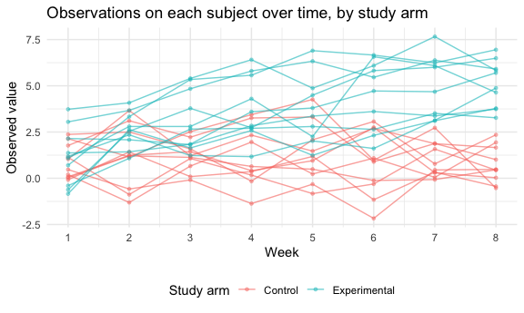
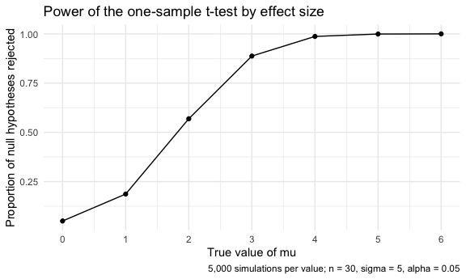
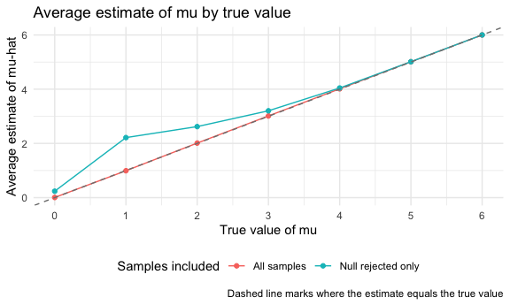

P8105 Homework 5
================
Meher Walia

``` r
library(tidyverse)

knitr::opts_chunk$set(
  fig.width = 6,
  fig.asp = .6,
  out.width = "90%"
)

theme_set(theme_minimal() + theme(legend.position = "bottom"))

set.seed(1)
```

## Problem 1

``` r
bday_sim = function(n) {
  
  bdays = sample(1:365, size = n, replace = TRUE)
  
  duplicate = length(unique(bdays)) < n
  
  return(duplicate)
  
}
```

``` r
bday_results = 
  expand_grid(
    group_size = 2:50,
    iter = 1:10000
  ) |> 
  mutate(has_duplicate = map_lgl(group_size, bday_sim)) |> 
  group_by(group_size) |> 
  summarize(prob_shared = mean(has_duplicate))
```

``` r
bday_results |> 
  ggplot(aes(x = group_size, y = prob_shared)) + 
  geom_line() + 
  geom_point(alpha = .5) + 
  geom_hline(yintercept = 0.5, linetype = "dashed", color = "red") + 
  labs(
    title = "Probability of at least one shared birthday, by group size",
    x = "Group size",
    y = "Probability of a shared birthday",
    caption = "10,000 simulations per group size")
```


The probability of at least one shared birthday increases steadily with
group size, following an S-shaped curve. The probability is very small
for groups of fewer than ten people, rises steeply between roughly 15
and 35, and then flattens as it approaches one. With 23 people the
probability is 0.502, crossing 50% at a group size most people find
surprisingly small; by 50 people it reaches 0.972. The result is
counterintuitive because people tend to think about how many others
share *their own* birthday rather than how many pairs exist in the
group. A group of 23 contains 253 distinct pairs, and only one of them
needs to match.

## Problem 2

``` r
study_df = 
  tibble(
    file_name = list.files("./data/data")
  ) |> 
  mutate(
    data = map(file_name, \(x) read_csv(str_c("./data/data/", x), show_col_types = FALSE)),
    subject = str_remove(file_name, ".csv")
  ) |> 
  unnest(data) |> 
  separate(subject, into = c("arm", "subject_id"), sep = "_", remove = FALSE) |> 
  mutate(
    arm = case_match(arm, "con" ~ "Control", "exp" ~ "Experimental"),
    arm = factor(arm, levels = c("Control", "Experimental"))
  ) |> 
  pivot_longer(
    week_1:week_8,
    names_to = "week",
    names_prefix = "week_",
    values_to = "value"
  ) |> 
  mutate(week = as.numeric(week)) |> 
  select(subject, arm, subject_id, week, value)

study_df
```

    ## # A tibble: 160 × 5
    ##    subject arm     subject_id  week value
    ##    <chr>   <fct>   <chr>      <dbl> <dbl>
    ##  1 con_01  Control 01             1  0.2 
    ##  2 con_01  Control 01             2 -1.31
    ##  3 con_01  Control 01             3  0.66
    ##  4 con_01  Control 01             4  1.96
    ##  5 con_01  Control 01             5  0.23
    ##  6 con_01  Control 01             6  1.09
    ##  7 con_01  Control 01             7  0.05
    ##  8 con_01  Control 01             8  1.94
    ##  9 con_02  Control 02             1  1.13
    ## 10 con_02  Control 02             2 -0.88
    ## # ℹ 150 more rows

``` r
study_df |> 
  ggplot(aes(x = week, y = value, color = arm, group = subject)) + 
  geom_line(alpha = .6) + 
  geom_point(alpha = .4, size = 1) + 
  scale_x_continuous(breaks = 1:8) + 
  labs(
    title = "Observations on each subject over time, by study arm",
    x = "Week",
    y = "Observed value",
    color = "Study arm")
```



``` r
week_means = 
  study_df |> 
  filter(week %in% c(1, 8)) |> 
  group_by(arm, week) |> 
  summarize(mean_value = mean(value), .groups = "drop")

week_means |> knitr::kable(digits = 2)
```

| arm          | week | mean_value |
|:-------------|-----:|-----------:|
| Control      |    1 |       0.92 |
| Control      |    8 |       0.74 |
| Experimental |    1 |       1.14 |
| Experimental |    8 |       5.12 |

At week 1 the two arms are indistinguishable. Group means are nearly
identical (0.92 in the control arm and 1.14 in the experimental arm),
and individual trajectories are fully intermingled. Over the following
weeks the experimental arm trends upward while the control arm stays
flat, ending at 5.12 and 0.74 respectively. By week 8 the groups have
almost completely separated: nearly every experimental subject sits
above nearly every control subject. Both arms show substantial
week-to-week variability within individual subjects, so single
observations are noisy; the difference between groups appears in the
trend across weeks rather than in any one measurement.

## Problem 3

``` r
sim_power = function(mu, n = 30, sigma = 5) {
  
  x = rnorm(n = n, mean = mu, sd = sigma)
  
  t.test(x) |> 
    broom::tidy() |> 
    select(estimate, p.value)
  
}
```

``` r
sim_results_df = 
  expand_grid(
    true_mu = 0:6,
    iter = 1:5000
  ) |> 
  mutate(test_results = map(true_mu, sim_power)) |> 
  unnest(test_results)

sim_results_df
```

    ## # A tibble: 35,000 × 4
    ##    true_mu  iter estimate p.value
    ##      <int> <int>    <dbl>   <dbl>
    ##  1       0     1  -1.62    0.0545
    ##  2       0     2  -0.542   0.569 
    ##  3       0     3  -0.278   0.767 
    ##  4       0     4  -0.303   0.733 
    ##  5       0     5   0.406   0.637 
    ##  6       0     6   0.147   0.881 
    ##  7       0     7   1.20    0.191 
    ##  8       0     8  -0.0542  0.957 
    ##  9       0     9  -0.119   0.878 
    ## 10       0    10  -1.89    0.0712
    ## # ℹ 34,990 more rows

``` r
power_df = 
  sim_results_df |> 
  group_by(true_mu) |> 
  summarize(power = mean(p.value < 0.05))

power_df |> 
  ggplot(aes(x = true_mu, y = power)) + 
  geom_line() + 
  geom_point() + 
  scale_x_continuous(breaks = 0:6) + 
  labs(
    title = "Power of the one-sample t-test by effect size",
    x = "True value of mu",
    y = "Proportion of null hypotheses rejected",
    caption = "5,000 simulations per value; n = 30, sigma = 5, alpha = 0.05")
```



Power increases with effect size, but not linearly. When the true mean
is 0 the null is true, and the rejection rate of 0.05 reflects the type
I error rate rather than power — it lands close to alpha, as it should.
Power then rises steeply between mu = 1 and mu = 4, climbing from 0.19
to 0.99, before flattening as it approaches 1.

The flattening reflects diminishing returns: once an effect is large
relative to the standard error, it is detected nearly every time, and
making it larger cannot improve detection further. With n = 30 and sigma
= 5 the standard error is roughly 0.9, so a true mean of 4 sits more
than four standard errors from zero and is almost always significant.

``` r
estimate_df = 
  bind_rows(
    sim_results_df |> 
      group_by(true_mu) |> 
      summarize(avg_estimate = mean(estimate)) |> 
      mutate(sample = "All samples"),
    sim_results_df |> 
      filter(p.value < 0.05) |> 
      group_by(true_mu) |> 
      summarize(avg_estimate = mean(estimate)) |> 
      mutate(sample = "Null rejected only")
  )

estimate_df |> 
  ggplot(aes(x = true_mu, y = avg_estimate, color = sample)) + 
  geom_line() + 
  geom_point() + 
  geom_abline(intercept = 0, slope = 1, linetype = "dashed", color = "grey50") + 
  scale_x_continuous(breaks = 0:6) + 
  labs(
    title = "Average estimate of mu by true value",
    x = "True value of mu",
    y = "Average estimate of mu-hat",
    color = "Samples included",
    caption = "Dashed line marks where the estimate equals the true value")
```



Averaged across all samples, the estimate of mu tracks the true value
almost exactly - the “All samples” series sits on the 45-degree line at
every value. This is expected: the sample mean is an unbiased estimator
of mu, so averaging over 5,000 draws recovers the truth.

Among only those samples where the null was rejected, the average
estimate is noticeably larger than the true value when mu is small. At
mu = 1 the average estimate among rejected tests is 2.21, and at mu = 2
it is 2.62 - both well above the truth. The two series converge by mu =
4 and are indistinguishable at 5 and 6.

The sample average among rejected tests is therefore not approximately
equal to the true mu when the effect is small. Rejection is not a random
subset of samples: a test reaches significance only when the estimate
falls far enough from zero, so conditioning on rejection selects the
samples that happened to produce unusually large estimates. When power
is low, only those extreme samples are retained, and the conditional
average is inflated.

As mu increases, power approaches 1 and nearly every sample is rejected.
The “rejected” subset then becomes effectively the full set, the
selection disappears, and the conditional average converges on the true
value. This is why the gap closes from mu = 4 onward.

At mu = 0 the conditional average sits near zero despite the same
selection effect, because rejections occur symmetrically in both tails -
the unusually large positive and negative estimates cancel when
averaged.
