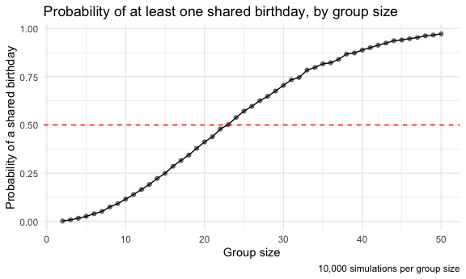

P8105 Homework 5
================
Meher Walia

``` r
library(tidyverse)

knitr::opts_chunk$set(
  fig.width = 6,
  fig.asp = .6,
  out.width = "90%"
)

theme_set(theme_minimal() + theme(legend.position = "bottom"))

set.seed(1)
```

## Problem 1

``` r
bday_sim = function(n) {
  
  bdays = sample(1:365, size = n, replace = TRUE)
  
  duplicate = length(unique(bdays)) < n
  
  return(duplicate)
  
}
```

``` r
bday_results = 
  expand_grid(
    group_size = 2:50,
    iter = 1:10000
  ) |> 
  mutate(has_duplicate = map_lgl(group_size, bday_sim)) |> 
  group_by(group_size) |> 
  summarize(prob_shared = mean(has_duplicate))
```

``` r
bday_results |> 
  ggplot(aes(x = group_size, y = prob_shared)) + 
  geom_line() + 
  geom_point(alpha = .5) + 
  geom_hline(yintercept = 0.5, linetype = "dashed", color = "red") + 
  labs(
    title = "Probability of at least one shared birthday, by group size",
    x = "Group size",
    y = "Probability of a shared birthday",
    caption = "10,000 simulations per group size")
```



## The probability of at least one shared birthday increases steadily with group size, following an S-shaped curve. The probability is very small for groups of fewer than ten people, rises steeply between roughly 15 and 35, and then flattens as it approaches one. With 23 people the probability is 0.502, crossing 50% at a group size most people find surprisingly small; by 50 people it reaches 0.972. The result is counterintuitive because people tend to think about how many others share *their own* birthday rather than how many pairs exist in the group. A group of 23 contains 253 distinct pairs, and only one of them needs to match.
